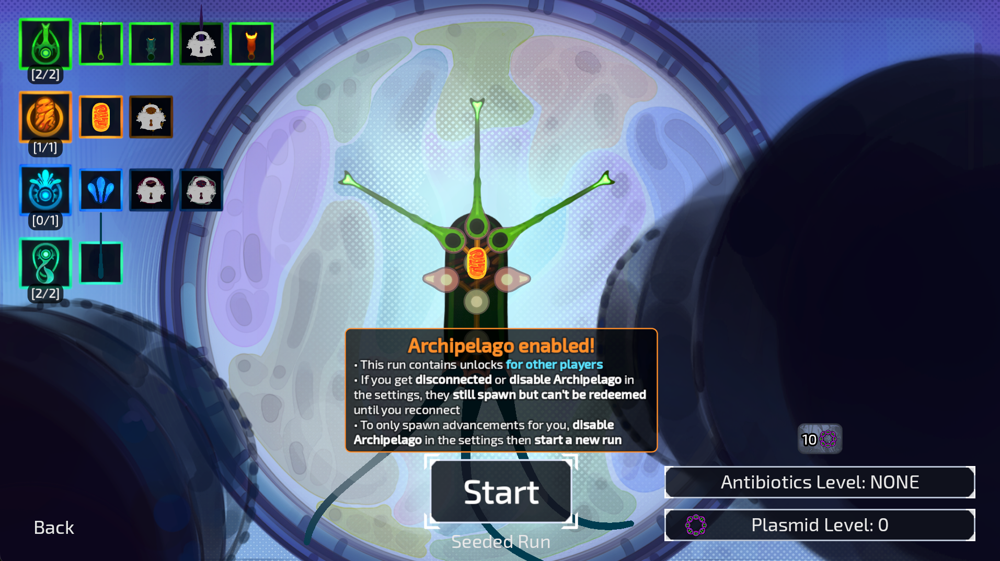
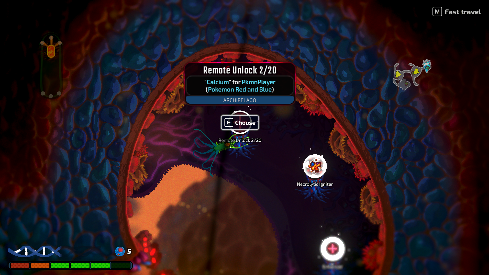
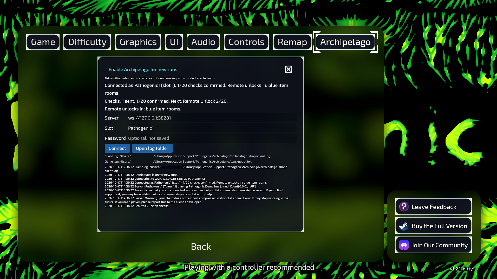

# Pathogenic: Archipelago Shop

[Archipelago](https://archipelago.gg) multiworld mod for [Pathogenic](https://store.steampowered.com/app/3808690/) on [Steam Workshop](https://steamcommunity.com/sharedfiles/filedetails/?id=3821496115).

## Versions

- Pathogenic 1.2.1 (Steam app 3808690)
  - Godot 4.7.2
  - Mod Loader 7.0.1
- Archipelago 0.6.7 or newer (tested with 0.6.7 and 0.6.8)

## Screenshots







## Player options

```yaml
name: Pathogenic{number}   # slot name; {number} becomes 1, 2, ... (Pathogenic1)
game: Pathogenic
description: Persistent numbered remote unlocks across repeatable runs.
Pathogenic:
  shop_checks: 20            # Total Remote Unlock checks across all runs

  # Where Remote Unlocks appear. At least one must be true:
  shop_unlocks: false        # one coin pedestal in every shop
  item_room_unlocks: true    # one free pedestal in every blue item room
  boss_reward_unlocks: false # one choice of every boss bodypart reward
  level_up_unlocks: false    # last card of every level-up mutation draft

  # ignore:
  progression_balancing: 50
  accessibility: full
```

## Example: Running Pokémon Red and Pathogenic

Put these files in one folder:

| File | Get it from |
| --- | --- |
| `PkmnPlayer.yaml` | [Pokémon Red and Blue options page](https://archipelago.gg/games/Pokemon%20Red%20and%20Blue/player-options) |
| `Pathogenic.yaml` | [Pathogenic.yaml](Pathogenic.yaml) from this repository (Pathogenic is a custom game, so archipelago.gg has no options page for it) |
| `pathogenic.apworld` | [Releases](https://github.com/ViMaSter/pathipelago/releases/latest) |
| `generate.sh`, `host.sh` | [example/generate.sh](example/generate.sh), [example/host.sh](example/host.sh) |

1. Run `./generate.sh` in that folder
2. Run `./host.sh` and forward TCP port `38281` for players outside your network
3. For Pokémon:
   - Take the `.apred` patch from `output/` and [apply it](https://archipelago.gg/tutorial/Pokemon%20Red%20and%20Blue/setup_en)
   - Connect to `<host address>:38281` as `PkmnPlayer`
4. For Pathogenic:
   - Subscribe to the [Workshop item](https://steamcommunity.com/sharedfiles/filedetails/?id=3821496115)
   - Start the game
   - Open **Settings > Archipelago**.
8. Turn on **Enable Archipelago for new runs**
0. Set config:
   - **Server** to `ws://<host address>:38281`
   - **Slot** to `Pathogenic1`
   - Click **Connect**
10. Start a **new** run
