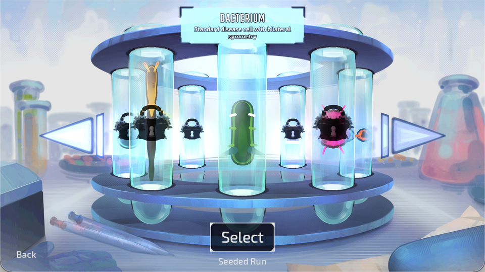
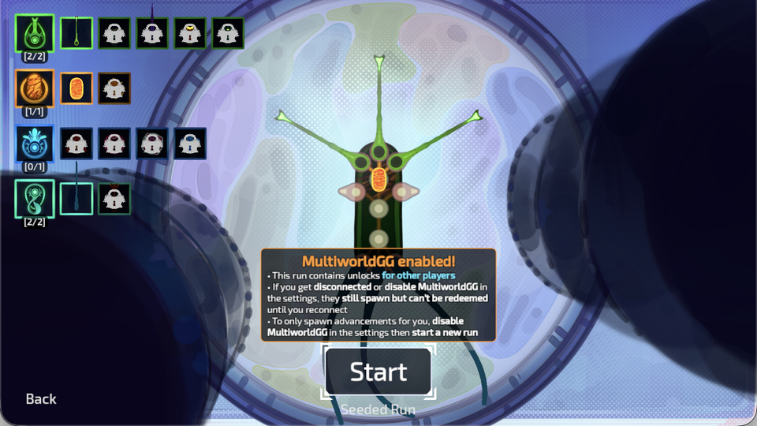
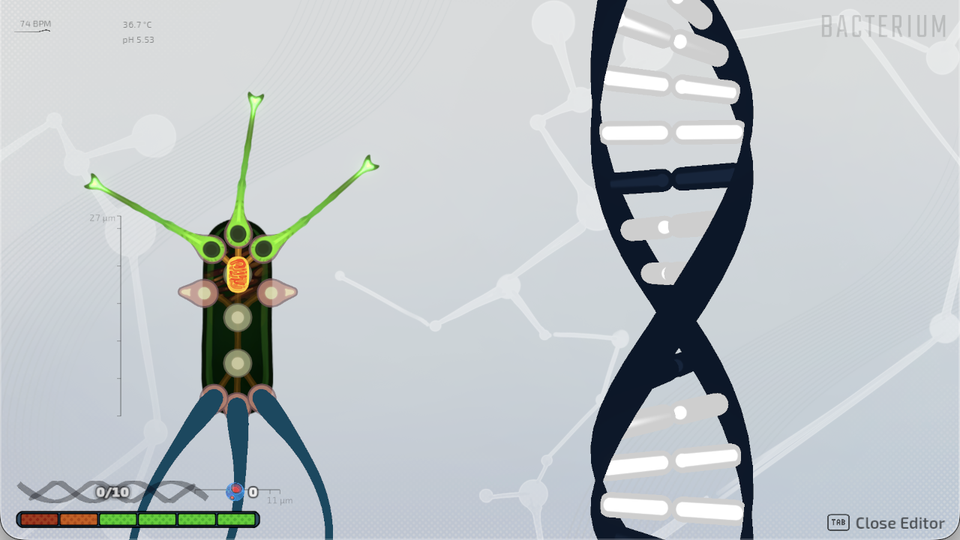
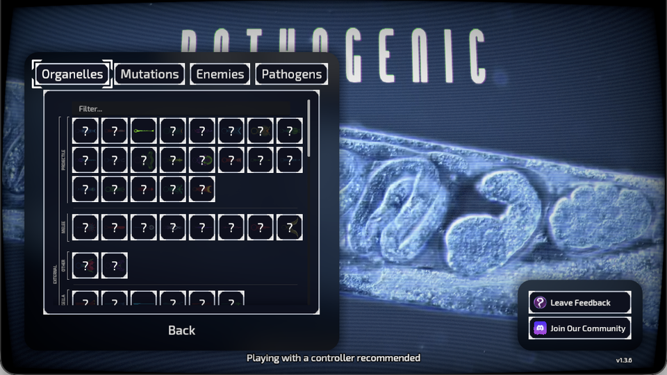

# Pathogenic: MultiworldGG Shop

[Subscribe on Steam Workshop](https://steamcommunity.com/sharedfiles/filedetails/?id=3821496115)

Send items to other players through shops, item rooms, boss rewards, and level-ups.
Coins, DNA, and Plasmid Fragments can fill additional checks, with amounts set in the YAML.
Currency rewards wait for a living campaign run and progress carries over between runs.
Version 0.2 also receives permanent character, Plasmid, and starting-loadout
unlocks in a separate server-bound campaign.
Version 0.3 shares Plasmid unlocks between characters as **Plasmid Slot** items.
Version 0.4 delivers organelles straight into the in-run Editor, the same way picked-up rewards are offered.

## Setup

1. Subscribe on [Steam Workshop](https://steamcommunity.com/sharedfiles/filedetails/?id=3821496115) and start Pathogenic.
2. Open **Settings > MultiworldGG**.
   The installed mod version is displayed at the top of the tab.
3. Enter the room's address, slot name, and password if needed. A bare host or IP
   (for example `203.0.113.5`) uses the default MultiworldGG port **38281**; add
   `:port` for another port. Without a scheme the mod tries `wss://` first, then
   `ws://`, and reports an error only if both fail. An explicit `ws://` or
   `wss://` URL is used as given.
4. Turn on **Enable MultiworldGG for new runs** and click **Connect**.
5. On the first launch after installing this version, restart Pathogenic once
   when Mod Loader requests it. Progression hooks require that restart; campaign
   starts remain blocked until they are active.
6. Wait for the campaign to connect and synchronize, then start or continue its run.
   Enabling and connecting keep Settings open while the isolated profile and
   its menus refresh. A blue unlock-style notification confirms successful
   synchronization with the server address and slot name.

The connection button shows **Cancel** while dialing, authenticating, or
synchronizing, and **Disconnect** once ready. Cancelling stops the entire
connection attempt, including automatic `wss://` → `ws://` fallback.
Disconnecting keeps the isolated campaign selected and blocks remote transactions
until you explicitly connect again; it never loads a normal save.

### Game compatibility and startup recovery

The mod targets **Pathogenic v1.3.4**. This game version added a pickup
participant argument to shop callbacks and reward signals; older mod builds can
fail to parse and trigger Mod Loader recovery mode. Update the complete mod ZIP
and keep only one installed copy (Workshop or local development ZIP).
Release **0.2.4** and later include these compatibility fixes and scopes the CI test server
to the fixture worlds so unrelated game imports cannot delay its startup.
After updating, re-enable MultiworldGGShop in Mod Loader if recovery disabled it
and restart once if requested to regenerate the progression hooks.

The mod is also verified against **Pathogenic v1.3.15**. From v1.3.13, reward
pedestals connect their pickup to `take_reward(taker)`, and from v1.3.15 the shop
callbacks default the taker to the local player. Older mod builds fail to
parse `shop_item.gd` on v1.3.15, so update the complete mod ZIP.

Use the address from the current room; include its port unless the room uses
the default 38281. If a previous
connection reported incompatible slot data, correct the address and restart
Pathogenic before connecting again. Start remains blocked until the campaign
has synchronized; this prevents falling back to a normal save after an error.

## Generate a room

1. Get `pathogenic.apworld` through the [Workshop page](https://steamcommunity.com/sharedfiles/filedetails/?id=3821496115).
2. Install it in the [MultiworldGG generator](https://multiworld.gg/downloads).
3. Add [Pathogenic.yaml](Pathogenic.yaml) and the other players' YAML files, then generate locally.
4. Upload the generated ZIP to [multiworld.gg](https://multiworld.gg/uploads) and create a room.
5. Share the room page and use its assigned server address and port.

Alternatively, put the APWorld, YAML files, [generate.sh](example/generate.sh),
and [generate.py](example/generate.py) in one folder and run `bash generate.sh`.
Requires Python 3.13.5+ below 3.14, or 3.12.7+ below 3.13.

## Options

```yaml
name: Pathogenic{number}
game: Pathogenic
Pathogenic:
  progression_balancing: 50  # ignored: every location is always reachable
  accessibility: full        # ignored: native feats are optional, never logic gates
  
  death_link: true            # share deaths with other DeathLink games (default true)

  coin_checks: 20               # additional filler checks for Coins (0-10000)
  coin_amount: 15               # coins per Coins item (1-10000)
  dna_checks: 0                  # additional filler checks for DNA (0-10000)
  dna_amount: 1                  # DNA per DNA item (1-10000)
  plasmid_fragment_checks: 0     # additional filler checks for Plasmid Fragments (0-10000)
  plasmid_fragment_amount: 1     # fragments per item (1-10000)
  
  # where you can unlock things
  shop_unlocks: false         # coin shops
  item_room_unlocks: true     # blue item rooms
  boss_reward_unlocks: false  # boss rewards
  level_up_unlocks: false     # level-up drafts

  start_with_all_characters: false  # full roster from the start; omits character items/checks

  # things other people can unlock
  remote_characters: true
  remote_plasmids: true      # 36 shared Plasmid Slot items (see below)
  remote_loadouts: true
  remote_organelles: true    # 89 organelle deliveries opened in the in-run Editor (see below)

  required_victories: 0        # wins needed in addition to sending every randomized shipment (0-50)
```

Keep at least one source enabled.

The goal is to send every randomized shipment and win `required_victories` MultiworldGG runs (default 0).
Victories persist across runs and reconnects; continuing or replaying a victory callback does not count it twice.
Vanilla and daily runs do not count.

## Permanent unlocks and natural acquisition

The installed v1.2.1 catalogue contains **309 unlocks**: 5 characters, 216
character-specific Plasmid nodes, 68 starting-loadout options, 14 organelle-drop
gates, and 6 environment features. Characters, Plasmids, and starting loadouts can be
randomized. A starting-loadout unlock is distinct from that organelle's random-drop gate.

In a MultiworldGG campaign every organelle's random-drop gate is always open, so
all organelles can drop from the start. Environment features (Antibiotics,
Experiments, Endless Mode, ...) are never randomized and keep their normal unlock
requirements.

### Where remote unlocks appear

These screenshots show example Pathogenic screens for each category; they are not
item-receipt popups, and the captured screens do not necessarily show a newly
received item.

<table>
<tr>
<td><strong><code>remote_characters</code></strong><br>Unlocks characters in the character selector.<br></td>
<td><strong><code>remote_loadouts</code></strong><br>Unlocks character-specific starting-loadout choices in the loadout editor.<br></td>
</tr>
<tr>
<td><strong><code>remote_plasmids</code></strong><br>Received Plasmid Slots unlock map nodes. Assign or unassign them manually in the in-run Editor; adjacency and connectivity still apply.<br></td>
<td><strong><code>remote_organelles</code></strong><br>Each received organelle opens the in-run Editor holding that part, exactly like buying it in a shop or taking it from an item room: place it on your organism or discard it.<br></td>
</tr>
</table>

### Plasmid slots

Plasmids are not sent as 216 per-character items. Instead, each character's map is
numbered by distance from its starting node (ties by node name): slot 1 is next to
the start, higher slots are further out. **Plasmid Slot N** unlocks the Nth Plasmid
of *every* character, so a slot received from another player helps whichever
character you play. The Bacterium has 36 Plasmids and every other character 30, so
there are 36 slot items and slots 31–36 only affect the Bacterium. Organelles are
already global unlocks and loadouts stay per character.

Buying a Plasmid's node with points unlocks it for that character only and sends
that slot's optional **Earn Plasmid Slot N** check the first time any character
buys it. These 36 checks hold randomized items; they do not unlock other
characters' Plasmids. Received slots still need map connectivity to be assigned.

Remote starting-loadout items unlock the matching character's editor choice,
including when received while that editor is open. The lock and disabled styling
refresh immediately. Shared bodyparts remain separate per-character unlocks.
Newly granted permanent unlocks also show in the MultiworldGG notification label
in the main menu and during runs.
The browser's randomized shipment count is distinct from **Server owns**: the
latter also includes unlocks earned through optional native-feat checks.

### Organelle deliveries

With `remote_organelles: true` the item pool contains one **Organelle: ...** item
for every organelle that can drop in a run (89; every character shares the same
pool), each with its own randomized shipment check. With `false` nothing changes:
organelles only come from the game itself (their drop gates are still open).

Received organelles go into a persistent queue and are handed out oldest first:

- The Editor opens holding the organelle only while you are swimming freely in a
  MultiworldGG run: not in a menu, paused, in a cutscene, already in the Editor, or
  in a combat room (the Editor cannot close there while holding a part).
- Further organelles received meanwhile wait; the held part is never replaced.
- After you place or discard it and the Editor closes, the next one opens once you
  have had control for at least two seconds.
- An organelle counts as delivered only after its Editor closes. If the run ends or
  the game quits first, it is offered again in the next run, so nothing is lost.

`python3 tools/live_organelle_test.py run` (macOS, game installed through Steam)
exercises this end to end against a local server. It installs the freshly built mod
temporarily, sends two organelles, places them through the real UI, and restores
everything afterwards. Pass `--keep` to leave the session running, then use the
`state`, `shot`, `send ID`, `key` and `teardown` subcommands.

### Shipment counts

All four remote categories default on. The generator creates one shipment for each
enabled character and loadout unlock, each Plasmid slot, and each organelle
(73 + 36 + 89 = 198 with every category enabled) plus the configured currency checks. The 36 Earn Plasmid Slot checks add
36 Coins items to the pool.
Set `start_with_all_characters: true` to unlock the full roster immediately in the
isolated campaign. This overrides `remote_characters` and removes all five character
items, their five randomized shipments and their five optional Earn checks, rather
than leaving no-op rewards in other players' worlds. Other categories are unchanged
(193 unlock shipments remain when they are all enabled). The option defaults to
false; older seeds retain their existing behavior. Use the updated mod and APWorld
and generate a new seed to apply it; an existing room is not changed.
Each filler item awards its configured Coins, DNA, or Plasmid Fragments amount.
Disable categories before generation to keep their ordinary in-campaign acquisition
behavior. With all remote categories disabled and all currency checks set to zero,
there are no shipments and the goal is immediately complete if `required_victories` is 0.

Each selected character and loadout unlock also has an optional **Earn ...** location with a fixed
matching self-reward (Plasmids use the slot checks above). Either satisfy the original requirement in your campaign
or receive the item from another player: both routes unlock the same content.
Native feats submit checks and wait for server confirmation; remote items never
fabricate achievement statistics. Optional Earn locations do not count toward
the goal, so difficult feats are not required to finish the multiworld.

Server-owned Plasmid nodes can be assigned/unassigned without paying again.
Map adjacency and connectivity still apply. They do not refund generic respec
points or require buying a native cap increase. Buying an unowned node normally
remains a natural acquisition route.

Regenerate with the bundled APWorld to obtain the new item pool. Older schema
1-5 seeds remain compatible: schema 5 seeds keep their organelle-drop and
environment unlock items, schema 4 (0.2.x) seeds keep per-character Plasmid
items, and the Research Grant item (ID 402939001) of schema 1-3 seeds still
awards 15 coins. Upgrading does not add items to an existing seed.

## Save isolation

Enabling MultiworldGG in the menu selects an isolated staging profile before
native saves load. After server synchronization, a separate profile is selected
by **seed + team + slot**, with a full identity marker to reject mismatches.
Rehosting the same seed/slot resumes that campaign; a different seed or slot
does not share its progression.

Normal profiles, legacy saves, their active-profile pointer, run saves, and
keybind files are not imported, cleared, or used by the campaign. Only
server-received items, server-confirmed native unlock checks and Plasmids bought
in the campaign confer selected entitlements. Native attempts, run state, currency, and Plasmid assignments are
saved inside the campaign profile, not in a normal profile. Steam achievement
imports, achievement awards, and leaderboard uploads are suppressed there.

Game settings (volumes, language, display and gameplay options) are shared by
all isolated profiles through `multiworldgg_shop/preferences.json`. They are
first copied read-only from the normal profile, re-applied whenever MultiworldGG
connects, disconnects, or the game restarts, and changes made while isolated are
kept for the next campaign. They are never written back to a normal profile.

Start/Continue require a synchronized server connection. Disconnecting keeps the
campaign selected rather than falling back to a normal save. Return to the menu
and disable MultiworldGG to disconnect and restore normal profile routing.
Toggling during a run applies at the next menu; it never moves a running game
between profiles. Daily runs are unavailable while MultiworldGG is enabled,
because their automatic unlock bypass would not follow server entitlements.
Configuration, identity, or journal errors block play rather than resetting data
or opening a normal save.

DeathLink works in both directions: deaths in other participating games deal
guaranteed lethal damage to your current MultiworldGG run, and your deaths are
sent to them. While paused or editing upgrades, the hit waits until gameplay
resumes in that same run. Deaths outside a living MultiworldGG run are ignored,
and deaths are not replayed after reconnecting. Vanilla runs are unaffected.
Set `death_link: false` before generating to disable it. Older seeds without
this option keep DeathLink off; regenerate with the updated APWorld to enable it.

## Publishing

Version tags (`vX.Y.Z`) run CI, create a GitHub release, and update the existing
Steam Workshop item after approval in the `steam` environment. The upload explicitly
sets Workshop visibility to **private** and contains only the built mod ZIP.
